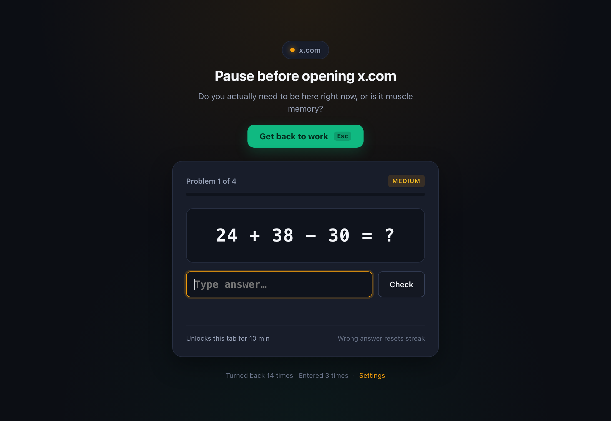
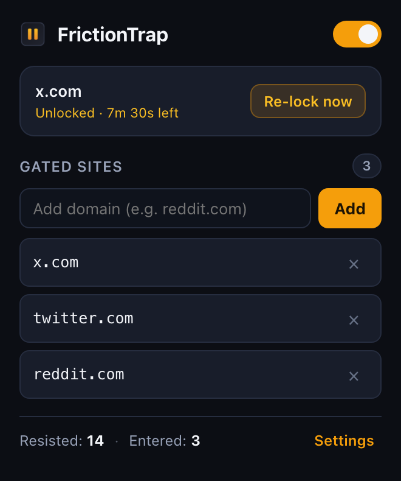
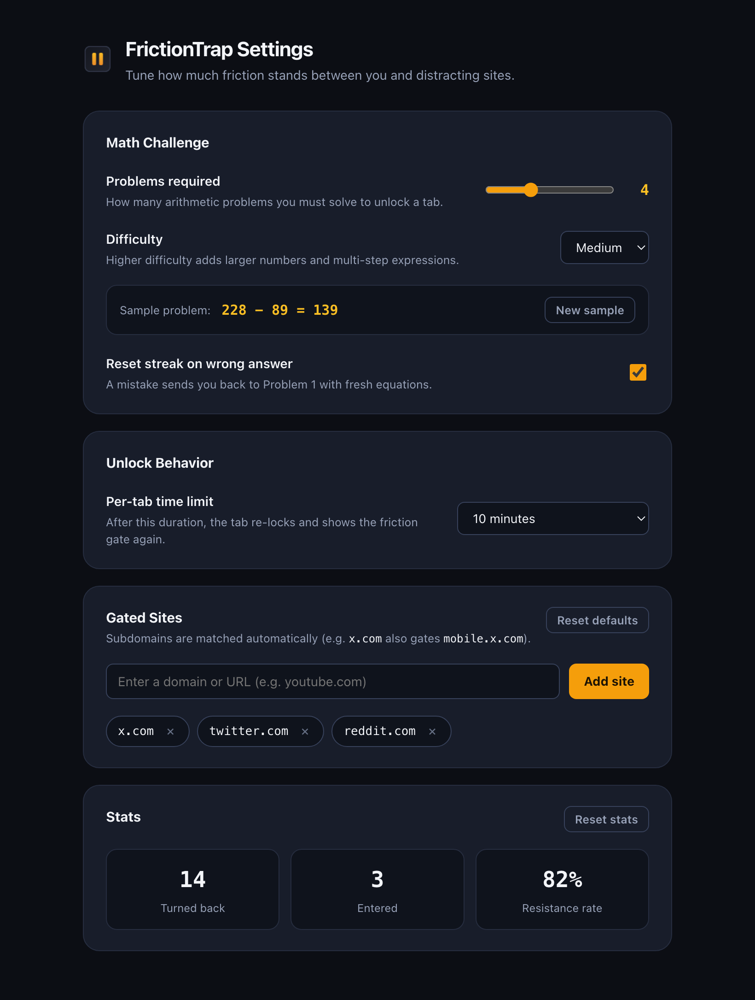

# FrictionTrap

> A lightweight Chrome extension that puts a deliberate pause in front of distracting sites—just enough friction to make you reconsider and get back to work.


<p align="center">
  
</p>

---

## Why FrictionTrap?

Hard site blockers are easy to disable the moment you actually need to check a link. **FrictionTrap** takes a different approach: instead of banning sites outright, it intercepts the tab *before the page loads* and puts up a calm, full-screen gate with a short streak of addition and subtraction problems.

Most of the time, that 15-second speed bump is all it takes to realize you opened X out of muscle memory, hit **`Esc`**, and get back to what you were doing.

## Features

- **Pre-load full-screen gate** — Intercepts navigation before the target site renders. No feed flash, no unread badges, no autoplay.
- **One-key escape** — Press `Esc` or click **Get back to work** to close the tab immediately and increment your resistance counter.
- **Dynamic site list** — Preloaded with `x.com` and `twitter.com`. Add or remove any domain from the toolbar popup or settings page; subdomains match automatically (e.g. `x.com` also gates `mobile.x.com`).
- **Tunable math friction** — Addition and subtraction only (designed to deter, not feel like a math exam), with configurable problem count (`1–10`), difficulty (`Easy`, `Medium`, `Hard`), and optional streak reset on wrong answers.
- **Per-tab unlock with optional timer** — Passing the challenge unlocks only that tab, and automatically re-locks it when your session timer expires (default `10 min`, or `Until tab closes`).
- **Privacy-first & zero build step** — Plain HTML, CSS, and ES modules. Runs 100% locally with no telemetry, no external requests, and no `<all_urls>` host permissions.

## Screenshots

| Toolbar Popup | Settings Page |
| :---: | :---: |
|  |  |

## Installation (Unpacked in Chrome)

FrictionTrap is meant to be loaded directly from source—no Chrome Web Store or build step required.

1. Clone this repository:
   ```bash
   git clone https://github.com/arosemena/frictiontrap.git
   ```
2. Open `chrome://extensions` in Chrome (or any Chromium-based browser).
3. Turn on **Developer mode** (top-right corner).
4. Click **Load unpacked** and select the cloned `frictiontrap` folder.
5. *(Optional)* Pin **FrictionTrap** to your toolbar for quick access to your site list, pause toggle, and one-click tab re-lock.

## How It Works

```
Navigate to x.com
       │
       ▼
background.js (webNavigation.onBeforeNavigate)
       │
       ├── Valid per-tab grant in chrome.storage.session? ──► Allow page to load
       │
       └── No grant / expired ──► Redirect tab to gate.html
                                        │
                       ┌────────────────┴────────────────┐
                       ▼                                 ▼
              Press Esc / Bail                  Solve math streak
             (closes tab, +1 win)        (grants tab access + starts alarm)
```

## Project Structure

```text
frictiontrap/
├── manifest.json       # Chrome Extension Manifest V3 config
├── background.js       # Navigation interception, per-tab grants, re-lock alarms
├── gate.html/css/js    # Full-screen friction gate & math challenge UI
├── popup.html/css/js   # Toolbar popup for quick toggles & site management
├── options.html/css/js # Full settings page & resistance stats
├── shared/
│   ├── domains.js      # Domain normalization & subdomain matching
│   ├── math.js         # Addition/subtraction problem generator
│   └── storage.js      # chrome.storage.sync / local / session wrappers
├── styles/common.css   # Shared dark-mode design tokens
├── icons/              # 16px, 48px, 128px PNG icons
└── tests/run.mjs       # Zero-dependency Node unit tests
```

## Development & Tests

Edit any file and click the **Reload** icon on the FrictionTrap card in `chrome://extensions`.

Run the unit tests with Node:

```bash
node tests/run.mjs
```

## License

[MIT](LICENSE)
